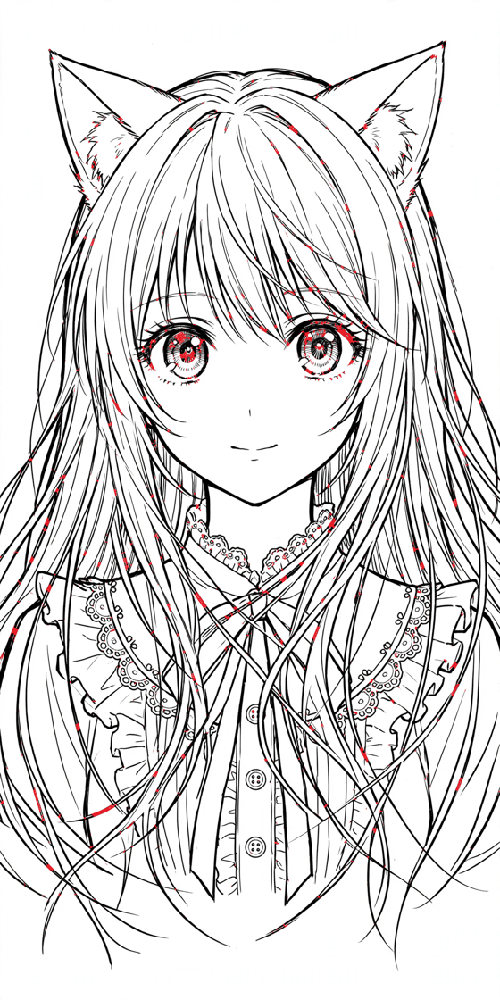
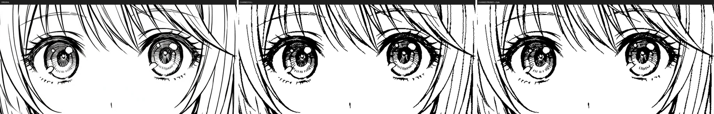

# line-trace-strokes

[](LICENSE)

ラスター線画を「可変半径ストローク」の JSON に変換し、JSON だけから画像を復元する一式。
さらに、交点で粉砕された短いストロークを方向の連続性で繋ぎ直すチェイン化により、
データを保ったまま編集しやすい形にする。

## テスト結果（アニメ風線画 1120×2240）

左が元の線画、中央がストローク JSON **だけ** から復元した画像、右が誤差の重ね合わせ
（青＝欠損、赤＝過剰）。全体図では元と復元の見分けがつかない水準まで戻る。


拡大すると差が見えてくる。復元線の輪郭には、中心・半径が整数ピクセル標本であることに
由来する階段状の波打ちが残る（目の拡大、左＝元／中央＝従来復元／右＝誤差）。


レースと髪の交差部。交差・小円・ボタンなどのトポロジーは崩れていない。


入力そのものと復元単体は `examples/anime/anime_input.png` /
`examples/anime/medial_json_restored.png` / `examples/anime/medial_chained_restored.png` にある。

## パイプライン

```
ラスター線画 (PNG)
  │  line_trace.py      二値化 → 骨格化 → EDT で半径を付与
  ▼
variable-radius-strokes v1 JSON   （各点が x, y, r を持つストローク列）
  │  chain_strokes.py   分岐点で端点を直進ペアリングして連結（任意）
  │  prune_strokes.py   ごく短いストロークの除去（任意、チェインの後に）
  ▼
繋がったストローク JSON
  │  render_strokes.py  JSON だけから AA 付きで復元
  ▼
復元画像
```

- `line_trace.py` — グレースケール ≤180 で二値化し、`skeletonize` または
  `medial_axis` で中心線を取り、元の二値マスクの距離変換 (EDT) から各点の半径 `r` を拾う。
  骨格グラフを次数≠2 の点（端点・分岐点）で分割してストローク化する。
- `render_strokes.py` — JSON のみから、各点を 0.35px 間隔で補間しながら
  半径 `r − 0.5` の円をスタンプし、3倍解像度から縮小して AA を付ける。
  `--reference` を付けると元画像との IoU・欠損・過剰を測れる。
- `chain_strokes.py` — 分岐点に集まった端点を「到着方向と出発方向が最も直進に
  近い相手」でペアリングし、ストロークを連結する。幾何には触らないので
  復元結果は変わらない（下記検証）。繋がらなかった短いストローク
  （棘・点・毛先の破片）は独立したまま残る。
- `prune_strokes.py` — 点数が閾値以下のストロークを除去する。
  チェイン化の後に使うこと（理由は下記の除去実験）。
- `render_smooth.py` — 実験版の復元。Catmull-Rom 補間で中心線を滑らかにして
  なぞる。画素周期のジッター対策の検証用（本筋は上記3本）。

## 使い方

```bash
python -m venv .venv && .venv/bin/pip install numpy scipy scikit-image pillow

# トレース (medial-axis 推奨)
.venv/bin/python line_trace.py input.png -o strokes.json --method medial-axis --preview-prefix medial

# チェイン化
.venv/bin/python chain_strokes.py strokes.json -o strokes_chained.json

# ごく短いストロークの除去（任意。チェインの後に、5点以下までが安全圏）
.venv/bin/python prune_strokes.py strokes_chained.json 5 strokes_pruned.json

# JSON だけから復元 + 元画像と比較
.venv/bin/python render_strokes.py strokes_chained.json -o restored.png \
    --reference input.png --difference diff.png --overlay overlay.png --metrics metrics.json
```

## 実測結果（アニメ風線画 1120×2240、`examples/anime/`）

入力は猫耳・レース・髪の交差を多く含む生成線画。インク画素 417,773（閾値180）。

| 方式 | ストローク数 | 点数 | IoU | 欠損 | 過剰 |
|---|---:|---:|---:|---:|---:|
| skeletonize | 9,027 | 119,312 | 89.07% | 42,742 | 3,294 |
| medial-axis | 10,434 | 122,086 | 93.43% | 23,549 | 4,169 |
| medial-axis + チェイン化 | **3,890** | 115,542 | **93.43%** | 23,550 | 4,168 |

チェイン化の内訳: 分岐点 6,315 箇所で 6,545 組を連結。平均長 11.7点 → 29.7点、
最長 454 → 781点、5点以下の断片 6,751本 → 1,952本。
20点以上のストロークが全点の86%をカバーする（チェイン前は65%）。

### チェイン化で復元が劣化しないことの検証

太い線や交点にある細かいストロークも復元に寄与しているはずであり、
チェイン化でそれらを失えば復元は劣化する。実際に失われていないことの確認:

- 点数の減少 6,544点 = 連結箇所で二重になっていた分岐点の重複そのもの。
  短いストロークは捨てられていない。
- 復元画像同士の直接比較: 二値で食い違うのは **全2,508,800画素中 2画素** のみ
  （分岐点で端点スタンプが重なっていた箇所が1pxずつ変わる）。
  グレースケール差も50画素のみ。`examples/anime/comparison_chained_diff_zoom.png` 参照。

### 短いストロークの除去実験

点数が閾値以下のストロークを捨ててから復元するとどうなるか（`prune_strokes.py`）。
除去しない場合の IoU は 93.43%。

| 除去する短さ | 未チェインから除去 | チェイン済みから除去 |
|---|---:|---:|
| ≤2点 | 93.35%（2,945本除去） | — |
| ≤3点 | 92.89%（4,498本） | 93.44%（1,101本） |
| ≤5点 | 90.18%（6,751本） | **93.44%（1,952本）** |
| ≤10点 | 83.04%（8,254本） | 92.72%（2,447本） |

- 未チェインで ≤5点まで捨てると IoU は −3.25pt に留まるが、**視覚的には目が壊れる**。
  瞳の放射状の刻み・下まつ毛・細い髪の流れが点線化して消える。短いストロークの
  固有寄与は面積ではなく細部の密度に詰まっている
  （≤5点除去でだけ失われるインク 18,050px が目・耳の毛・髪の際に集中する）。




- 一方、**チェイン化の後なら ≤5点まで除去しても IoU は不変で、目もほぼ残る**。
  チェイン化が「長い線の一部だった断片」を先に回収するため、残る短いストロークは
  太いインク内部の冗長な棘が中心になる。捨てるならチェインの後に。



### 復元誤差の性質（medial-axis、未チェイン）

- 欠損の99%は元のインクの境界画素で、復元までの距離の中央値は1px。
  線が消えるのではなく、`r − 0.5` の一律引き算と整数ピクセル中心の離散化で
  全体が均一に少し細くなる。内側の欠損率は0.16%。
- 半径オフセットは −0.5 がほぼ最適（0 で過剰が爆増し IoU 77.4%、−0.25 で 92.7%）。
- 拡大すると中心と半径の画素周期ジッターで輪郭が階段状に波打つ。これが残る課題で、
  対策は復元側（平滑化してなぞる／ベクターレンダラに任せる）にある。

### 合成図形テストとの差

螺旋・交差・楕円などの合成図形 (1536×1024) では medial-axis で IoU 99.34% /
295ストロークだった。実線画で落ちる主因は精度よりもストロークの粉砕
（分岐点 210 → 7,914) であり、チェイン化はそこへの対処。

## 既知の限界

- IoU は二値化した線との重なりであり、グレーの AA や元の筆順の復元は意味しない。
- 8近傍グラフの分岐処理はヒューリスティクス。太い塊の内部では骨格が余分に枝分かれする。
- 中心・半径とも整数ピクセル標本が起点なので、サブピクセル精度はない。

## 今後の候補

- JSON → Blender グリースペンシル変換（ストロークとして編集・描画を任せる）。
- サブピクセル中心化（重み付き重心など）で輪郭の波打ちを元から減らす。

## ファイル

- `line_trace.py` / `render_strokes.py` / `chain_strokes.py` / `prune_strokes.py` /
  `render_smooth.py` — 本体
- `examples/anime/` — テスト入力・トレース結果 JSON（未チェイン／チェイン済み）・
  復元・比較画像

## ライセンス

MIT License（`LICENSE` 参照）。概念実証のための実装であり、手法自体は
骨格化・距離変換に基づく古典的なものである。自由に使ってよい。
