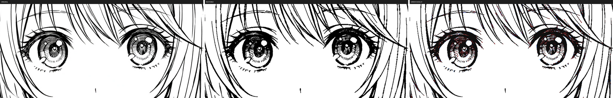

# line-trace-strokes

[](LICENSE)

ラスター線画を「可変半径ストローク」の JSON に変換し、JSON だけから画像を復元する一式。
さらに、交点で粉砕された短いストロークを方向の連続性で繋ぎ直すチェイン化により、
データを保ったまま編集しやすい形にする。

## テスト結果（アニメ風線画 1120×2240）

左が元の線画、中央がストローク JSON **だけ** から復元した画像、右が誤差の重ね合わせ
（青＝欠損、赤＝過剰）。全体図では元と復元の見分けがつかない水準まで戻る。


拡大すると差が見えてくる。復元線の輪郭には、中心・半径が整数ピクセル標本であることに
由来する階段状の波打ちが残る（目の拡大、左＝元／中央＝従来復元／右＝誤差）。



レースと髪の交差部。交差・小円・ボタンなどのトポロジーは崩れていない。


入力そのものと復元単体は `examples/anime/anime_input.png` /
`examples/anime/medial_json_restored.png` / `examples/anime/medial_chained_restored.png` にある。

## パイプライン

```
ラスター線画 (PNG)
  │  line_trace.py      二値化 → 骨格化 → EDT で半径を付与
  ▼
variable-radius-strokes v1 JSON   （各点が x, y, r を持つストローク列）
  │  subpixel_refine.py 中心を EDT 重心でサブピクセル化（標準工程）
  │  chain_strokes.py   分岐点で端点を直進ペアリングして連結（任意）
  │  prune_strokes.py   ごく短いストロークの除去（任意、チェインの後に）
  ▼
繋がったストローク JSON
  │  render_strokes.py  JSON だけから AA 付きで復元
  ▼
復元画像
```

- `line_trace.py` — グレースケール ≤180 で二値化し、`skeletonize` または
  `medial_axis` で中心線を取り、元の二値マスクの距離変換 (EDT) から各点の半径 `r` を拾う。
  骨格グラフを次数≠2 の点（端点・分岐点）で分割してストローク化する。
- `render_strokes.py` — JSON のみから、各点を 0.35px 間隔で補間しながら
  半径 `r − 0.5` の円をスタンプし、3倍解像度から縮小して AA を付ける。
  `--reference` を付けると元画像との IoU・欠損・過剰を測れる。
- `subpixel_refine.py` — 中心と半径のサブピクセル化（標準工程）。各内点で
  接線の法線方向に距離変換 (EDT) のプロファイルをサンプリングし、その重心へ
  中心を寄せ、半径はずらした中心で EDT を取り直す。整数ピクセル標本の
  量子化誤差を、ベクター側の平滑化（推測）ではなく入力側の情報から消す。
  IoU 93.43% → 97.40%（下記）。
- `chain_strokes.py` — 分岐点に集まった端点を「到着方向と出発方向が最も直進に
  近い相手」でペアリングし、ストロークを連結する。幾何には触らないので
  復元結果は変わらない（下記検証）。繋がらなかった短いストローク
  （棘・点・毛先の破片）は独立したまま残る。
- `prune_strokes.py` — 点数が閾値以下のストロークを除去する。
  チェイン化の後に使うこと（理由は下記の除去実験）。
- `render_smooth.py` — 実験版の復元。Catmull-Rom 補間で中心線を滑らかにして
  なぞる。画素周期のジッター対策の検証用（本筋は上記3本）。

## 使い方

```bash
python -m venv .venv && .venv/bin/pip install numpy scipy scikit-image pillow

# トレース (medial-axis 推奨)
.venv/bin/python line_trace.py input.png -o strokes.json --method medial-axis --preview-prefix medial

# 中心のサブピクセル化（標準工程）
.venv/bin/python subpixel_refine.py input.png strokes.json -o strokes_subpixel.json

# チェイン化
.venv/bin/python chain_strokes.py strokes.json -o strokes_chained.json

# ごく短いストロークの除去（任意。チェインの後に。≤5点は復元ほぼ無劣化、
# ≤10点まで削ると本数1,446・中央値34点と編集向けの粒度になる）
.venv/bin/python prune_strokes.py strokes_chained.json 5 strokes_pruned.json

# JSON だけから復元 + 元画像と比較
# （サブピクセル化したデータでは半径オフセット -0.35 が最適。未処理データは既定の -0.5）
.venv/bin/python render_strokes.py strokes_chained.json -o restored.png \
    --reference input.png --difference diff.png --overlay overlay.png --metrics metrics.json \
    --radius-offset -0.35
```

## 実測結果（アニメ風線画 1120×2240、`examples/anime/`）

入力は猫耳・レース・髪の交差を多く含む生成線画。インク画素 417,773（閾値180）。

| 方式 | ストローク数 | 点数 | IoU | 欠損 | 過剰 |
|---|---:|---:|---:|---:|---:|
| skeletonize | 9,027 | 119,312 | 89.07% | 42,742 | 3,294 |
| medial-axis | 10,434 | 122,086 | 93.43% | 23,549 | 4,169 |
| medial-axis + チェイン化 | **3,890** | 115,542 | **93.43%** | 23,550 | 4,168 |
| medial-axis + サブピクセル化（中心＋半径再計算） | 10,434 | 122,086 | **97.40%** | 5,008 | 5,994 |
| 〃 + チェイン化 | 3,909 | 115,561 | **97.40%** | 5,008 | 5,994 |

チェイン化の内訳: 分岐点 6,315 箇所で 6,545 組を連結。平均長 11.7点 → 29.7点、
最長 454 → 781点、5点以下の断片 6,751本 → 1,952本。
20点以上のストロークが全点の86%をカバーする（チェイン前は65%）。

### チェイン化で復元が劣化しないことの検証

太い線や交点にある細かいストロークも復元に寄与しているはずであり、
チェイン化でそれらを失えば復元は劣化する。実際に失われていないことの確認:

- 点数の減少 6,544点 = 連結箇所で二重になっていた分岐点の重複そのもの。
  短いストロークは捨てられていない。
- 復元画像同士の直接比較: 二値で食い違うのは **全2,508,800画素中 2画素** のみ
  （分岐点で端点スタンプが重なっていた箇所が1pxずつ変わる）。
  グレースケール差も50画素のみ。`examples/anime/comparison_chained_diff_zoom.png` 参照。

### 短いストロークの除去実験

点数が閾値以下のストロークを捨ててから復元するとどうなるか（`prune_strokes.py`）。
数値はサブピクセル化（中心＋半径再計算）後のデータで測定したもの
（復元オフセット −0.35、除去しない場合の IoU は 97.40%）。
それ以前の測定は git 履歴参照。
結論の向きは変わらず、全条件で IoU が底上げされた。
なおサブピクセル化後のチェイン化は 3,909本になる（方向ベクトルが微妙に
変わり、連結が19本分減る）。

| 除去する短さ | 未チェインから除去 | チェイン済みから除去 |
|---|---:|---:|
| ≤2点 | 97.31%（2,945本除去） | — |
| ≤3点 | 96.91%（4,498本） | 97.39%（1,114本） |
| ≤5点 | 94.45%（6,751本） | **97.39%（1,971本）** |
| ≤10点 | 87.49%（8,254本） | 96.71%（2,463本） |

- 未チェインで ≤5点まで捨てると IoU は −2.95pt に留まるが、**視覚的には目が壊れる**。
  瞳の放射状の刻み・下まつ毛・細い髪の流れが点線化して消える。短いストロークの
  固有寄与は面積ではなく細部の密度に詰まっている
  （≤5点除去でだけ失われるインク 17,541px が目・耳の毛・髪の際に集中する）。


- 一方、**チェイン化の後なら ≤5点まで除去しても IoU はほぼ不変で、目も残る**。
  ≤10点まで広げても −0.69pt に留まる。チェイン化が「長い線の一部だった
  断片」を先に回収するため、残る短いストロークは太いインク内部の冗長な棘が
  中心になる。捨てるならチェインの後に。


### 除去後のストローク構成（編集可能性）

チェイン済みから除去したとき、残りはどのくらいの長さにまとまるか。

| 条件 | 本数 | 中央値 | 平均 | 最長 | IoU |
|---|---:|---:|---:|---:|---:|
| チェインのみ | 3,909 | 5点 | 29.6点 | 781点 | 97.40% |
| ≤5点除去 | 1,938 | 22点 | 56.3点 | 781点 | 97.39% |
| ≤7点除去 | 1,666 | 28点 | 64.4点 | 781点 | 97.18% |
| ≤10点除去 | 1,446 | 34点 | 72.9点 | 781点 | 96.71% |

- ≤10点除去では21点以上が1,017本（全体の70%）を占め、インクの95%を
  20点以上のストロークが担う。100点以上のストロークでインクの64%をカバーし、
  髪の流れや輪郭などの骨格はこの層にある。バストアップ1枚で約1,400本・
  中央値34点は、ベクター編集で1本ずつ扱う粒度として現実的
  （1本＝髪1筋、輪郭1区間程度の意味のある単位になる）。
- 残る11〜20点の429本はノイズではなく、レースの小円・まつ毛・ボタンの縁など
  実在の小パーツである。除去は≤10点あたりが打ち止めで、それ以上は
  パーツ自体が消え始める。
- 注意: ストロークの切れ目は交点の位置にあるため、見た目に1本の線でも
  交点を跨ぐと2〜3本に分かれている。編集で動かす際は交点付近の追随が課題。
- 未チェインからの除去では本数は減っても骨格が弱いままである
  （≤10点除去で2,180本・中央値25点、≥50点のカバー率は57.9%止まり、
  IoU も87.49%まで落ちる）。編集の土台にするならチェイン経由が前提。

### 復元誤差の性質（medial-axis、未チェイン）

- 欠損の99%は元のインクの境界画素で、復元までの距離の中央値は1px。
  線が消えるのではなく、`r − 0.5` の一律引き算と整数ピクセル中心の離散化で
  全体が均一に少し細くなる。内側の欠損率は0.16%。
- 半径オフセットは −0.5 がほぼ最適（0 で過剰が爆増し IoU 77.4%、−0.25 で 92.7%）。
- 拡大すると中心と半径の画素周期ジッターで輪郭が階段状に波打つ。これが残る課題で、
  対策はトレース側のサブピクセル中心化にある（次節）。復元側の平滑化は
  推測になる分だけ不利で、実測でも IoU が下がった（Catmull-Rom 93.01%）。

### サブピクセル中心化（標準工程として採用）

中心と半径は整数ピクセル標本であり、その ±0.5px の量子化誤差が輪郭の
階段状ジッターになる。この誤差はベクター内平滑化（推測）ではなく、
トレース時に前段で消すのが正しい — という方針で検証し、標準工程に採用した
（`subpixel_refine.py`）。各内点で接線の法線方向に重みプロファイルを
サンプリングし、その重心へ中心を寄せる（±0.6px クランプ、端点は交点維持
のため固定、平均移動量 0.26px）。

| 重み | IoU | 欠損 | 過剰 | 中心線の凹凸（2階差分平均） |
|---|---:|---:|---:|---:|
| なし（整数中心） | 93.43% | 23,549 | 4,169 | 0.331px |
| **EDT（距離場）** | **95.90%** | **12,632** | 4,695 | 0.240px（−28%） |
| グレー濃度 | 93.46% | 22,144 | 5,525 | 0.204px（−39%） |

- EDT 重心が本命。欠損がほぼ半減する。EDT プロファイルは線の塊の中での
  中心を素直に表すため、量子化誤差だけを拾って直せる。
- グレー濃度重心は中心線自体は最も滑らかになるが IoU は動かない。
  隣接線や AA の濃淡に引っ張られ、塊の中心からずれるため。
  「滑らかさ」と「正確さ」は別物である。
- 半径は、ずらした中心で EDT を双線形サンプリングして取り直す。
  中心だけ直して半径が旧中心の値のままでは実測点がずれるためで、
  これにより **IoU 97.40%**（復元オフセット −0.35、欠損 5,008／過剰 5,994）
  まで伸びる。半径の平滑化（移動平均）は逆効果だった
  （±1点で 96.29%、±2点で 95.36%）：半径の段差はノイズではなく
  本当の幅変化を担っている。
- 濃度プロファイルの FWHM からの半径推定はベタ部の plateau で壊れた
  （IoU 75.95%）ため不採用。
- オフセットの最適は工程ごとに移る：整数中心 −0.5 → 中心のみ −0.4 →
  中心＋半径再計算 −0.35。従来の −0.5 最適は中心誤差の裏返しだった。


### 合成図形テストとの差

螺旋・交差・楕円などの合成図形 (1536×1024) では medial-axis で IoU 99.34% /
295ストロークだった。実線画で落ちる主因は精度よりもストロークの粉砕
（分岐点 210 → 7,914) であり、チェイン化はそこへの対処。

## 既知の限界

- IoU は二値化した線との重なりであり、グレーの AA や元の筆順の復元は意味しない。
- 8近傍グラフの分岐処理はヒューリスティクス。太い塊の内部では骨格が余分に枝分かれする。
- 中心と半径は `subpixel_refine.py` でサブピクセル化される。残る誤差は
  ポリライン近似（約1px間隔の標本を直線で繋ぐ）と残留中心ノイズが主で、
  これはベクター側の曲線フィッティングの領域である。

## 後処理：ε制約つき平滑化（`smooth_strokes.py`）

平滑化は測定ではなく編集（後処理）である。無制約の平滑化は忠実度を落とす
ことが実証済みのため、中心は実測位置から ε px、半径は実測値から ε_r px
以上は離れない制約のもとでラプラシアン緩和をかける。端点は固定され、
チェインの接続は保たれる。実測（基準：中心ジッター 0.249px／半径ジッター
0.159px／IoU 97.40%）：

| ε / ε_r / 反復 | 中心ジッター | 半径ジッター | IoU |
|---|---:|---:|---:|
| 0.15 / 0.08 / 15（既定） | 0.093 | 0.097 | 96.19% |
| 0.20 / 0.10 / 20 | 0.064 | 0.085 | 95.61% |
| 0.30 / 0.15 / 40 | 0.037 | 0.060 | 94.30% |

コストは構造的で、緩和が曲率を内側に切る方向へ制約予算を使うため、
滑らかさと忠実度は直接トレードオフになる。編集先で滑らかさが要る場合に
だけ使う。

## フォーマット変換：SVG（`svg_export.py`）

編集は他ソフトに任せる前提の汎用書き出し。

- **outline モード（既定）**：円盤掃引の和集合で作った塗りシルエット。
  テーパーを保持する。実測 IoU **96.09%**（simplify 0.1、2.2MB）／
  simplify 0 では 96.40%（8.3MB）。法線オフセットのリボン方式は急カーブで
  潰れるため不採用（90.17%）。輪郭抽出（マーチングスクエア）は AA の
  薄い橋で全体が1ループ化し不採用。
- **centerline モード**：1ストローク1パスの線。SVG の線幅は1パスに
  1値しか持てないため、線幅の変化（テーパー）はこの形式では表現できず
  失われる。
- 座標系の注意：JSON はピクセル中心座標、SVG は隅原点のため全体を
  (0.5, 0.5) 平行移動して出す。これを省くと IoU は ~79% まで落ちる。
- 輪郭の最適オフセットは −0.2。スタンプ復元の −0.35 との差は
  ラスタライザ側の太り（PIL の円描画）によるもので、データの差ではない。

## 今後の候補

- 本物の .clip 変換：半径付きベクターレイヤーを、.clip 内蔵の SQLite
  スキーマ経由で直接書く。フォーマット解析文書の所在確認が前提。
- 曲線フィッティング（ポリラインをベジェ列へ置き換える単純化）。

## ファイル

- `line_trace.py` / `render_strokes.py` / `subpixel_refine.py` / `chain_strokes.py` /
  `prune_strokes.py` / `smooth_strokes.py` / `svg_export.py` / `render_smooth.py` — 本体
- `examples/anime/` — テスト入力・トレース結果 JSON（未チェイン／チェイン済み）・
  復元・比較画像

## ライセンス

MIT License（`LICENSE` 参照）。概念実証のための実装であり、手法自体は
骨格化・距離変換に基づく古典的なものである。自由に使ってよい。
