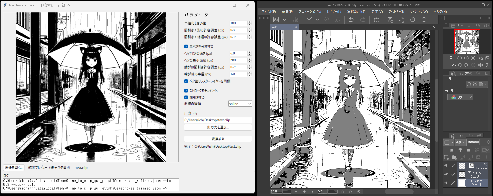
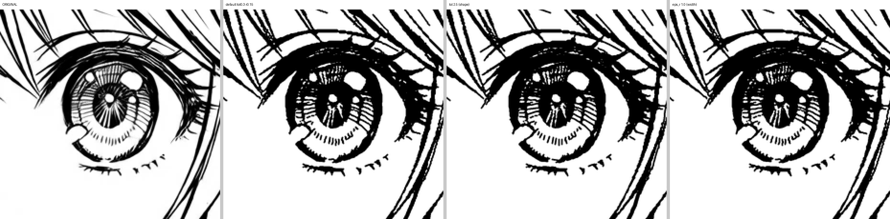
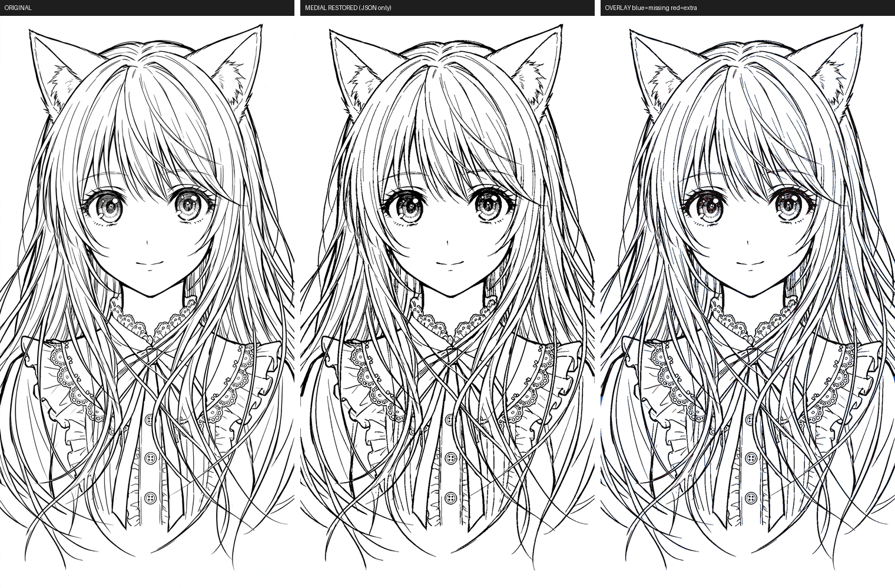
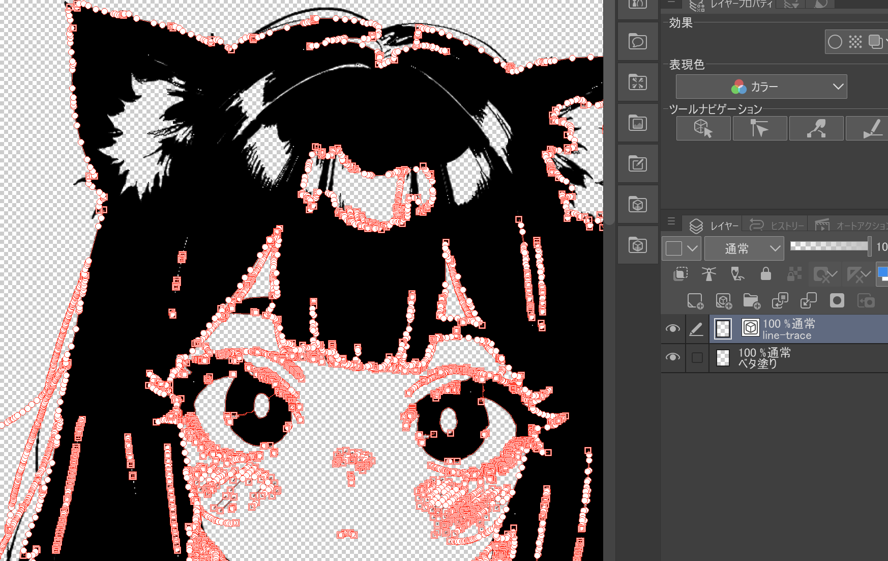

# line-trace-strokes

[](LICENSE)

ラスター線画を、**CLIP STUDIO PAINT のベクターレイヤー（`.clip`）** に変換するツールです。
線は1本ずつ線幅の変化（テーパー）つきでベクター化されるため、クリスタ上でそのまま編集できます。黒ベタは領域として分離し、輪郭を閉ストロークとして持ちつつ、塗りをラスターレイヤーとして下に同梱します。

`.clip` の読み書き自体は姉妹プロジェクト [clipvec](https://github.com/nekomimianko/clipvec) が担います。



## インストール

### GUI（Windows）

**[LineToClip-v1.5.zip をダウンロード](https://github.com/nekomimianko/line-trace-strokes/releases/download/v1.5/LineToClip-v1.5.zip)**
解凍して `LineToClip\LineToClip.exe` を実行してください（フォルダごと使うこと）。

- PyInstaller 製の実行ファイルです。
- Windows のセキュリティにブロックされることがあります。
- 初回起動は展開のため遅いです（ハングではありません）。2回目以降は速くなります。

### CLI

```bash
git clone --recursive https://github.com/nekomimianko/line-trace-strokes
cd line-trace-strokes
python -m venv .venv && .venv/bin/pip install -r requirements.txt
.venv/bin/python line_to_clip.py input.png -o output.clip
```

## 使い方

- **GUI**：画像をドラッグ＆ドロップするとプレビューが表示され、パラメータを調整して変換できます。二値化と黒ベタ検出（赤表示）はライブでプレビューに反映されます。
- **CLI**：`python line_to_clip.py input.png -o output.clip` で既定値の全工程が走ります。

どちらも既定値のまま実用になるように調整してあるため、基本はそのまま変換して問題ありません。

### 線がガタついて見えるときは

出力される `.clip` のキャンバスサイズは、入力画像のピクセル数そのままです。入力が 1024px 級だとモノクロ線の表現には解像度が足りないため、ベクター化の品質とは関係なく線がガタついて見えます。

CLIP STUDIO PAINT で開いた後に「画像解像度を変更」でキャンバスを大きくしてください。ベクターなので解像度を上げても線は劣化しません（モノクロ線画の目安は 600dpi、最低 2K〜4K 級推奨）。

## 主なパラメータ（GUI / CLI 共通）

- **二値化しきい値**（`--threshold`、既定 `180`）：グレースケールでこの値以下をインクとみなします。グレー塗りや影が多い画像では下げて調整します。
- **線修正**（`--no-refine` で無効）：線幅の微小なガタつきを抑えつつ制御点を減らして、手編集しやすい滑らかな線にします。
  - **線形状の許容誤差**（`--tol`、既定 `0.75px`）：大きくすると線の形がより単純・滑らかになり、小さくすると元画像への忠実度が上がります。
  - **線幅の許容誤差**（`--eps-r`、既定 `1.0px`）：大きくすると太さの細かい出入りが均されます。
- **黒ベタ**（`--no-beta` で無効）：太い黒塊を領域として分離し、輪郭を閉ストローク化します。
  - **ベタ判定の深さ**（`--beta-depth`、既定 `3px`）：この深さより太い塊をベタとみなします（幅 6px までの線は線として残ります）。
  - **ベタの最小面積**（`--min-region-area`、既定 `200px`）：これ未満の領域はベタにしません。
  - **輪郭形状／線幅の許容誤差**（`--contour-tol` 既定 `0.75px` / `--contour-eps-r` 既定 `0.35px`）・**輪郭線の太さ**（`--contour-radius` 既定 `1.0px`）
  - **ベタ塗りラスターレイヤーを同梱**（`--no-fill-layer` で無効）：ベタ領域の塗りレイヤーをベクターレイヤーの下に同梱します。
- **ストロークをチェイン化**（`--no-chain` で無効）：偽の短い棘を取り除き、交差部で分断された線を方向・位置・線幅の連続性で1本に繋ぎ直します。
- **曲線の種類**（`--curve`、既定 `spline`）：`.clip` の補間方式（`spline` / `straight`）。

左から元絵／忠実寄り（`tol 0.3, eps_r 0.15`）／形を滑らかに（`tol 2.5`）／線幅を均した例（`eps_r 1.0`）：



### CLI 追加オプション・他ソフト連携

- `--svg output.svg`：曲線フィッティング済みの輪郭 SVG も同時に出力します（要 `shapely`）。
- `--split-corner-deg DEG`：指定角度以上の急な角（L字・V字の折り返しなど）でストロークを別線に分割します（既定 `0`＝無効）。
- `--legacy-chain`：従来の単一分岐点チェイン方式に切り替えます。
- `--clipvec PATH`（または環境変数 `CLIPVEC_PATH`）：`clipvec` の場所を明示指定します。
- Blender グリースペンシルへ取り込む場合は、出力した `.clip` を [clipvec](https://github.com/nekomimianko/clipvec) 同梱のアドオン（`io_clip_vector`）で読み込めます。

---

## 技術詳細

ここから先は開発者・アルゴリズム詳細向けの情報です。

### パイプライン構成

```text
ラスター線画 (PNG)
  │  line_trace.py       二値化 → 骨格化 (medial-axis) → EDT で半径を付与
  ▼
variable-radius-strokes v1 JSON   （各点が x, y, r を持つストローク列）
  │  subpixel_refine.py  中心を EDT 重心でサブピクセル化＋半径再計算
  │  chain_strokes.py    棘剪定 → ジャンクション・クラスタリング＆再構成チェイン → 被覆ゴミ除去
  │  detect_beta.py      黒ベタ領域の検出（測地膨張）と輪郭抽出
  │  trim_strokes.py     ベタ輪郭での切り取り（微小オーバーラップ＋縁ゴミ除去）
  │  refine_strokes.py   線幅バイラテラル平滑化 → 極値配置細分 → 事後プルーニング
  ▼
整理済みストローク JSON
  │  clipvec             .clip ベクターレイヤー＋ベタ塗りラスターレイヤー書き出し
  │  fit_curves.py       （任意）曲線フィッティング済み輪郭 SVG 書き出し
  │  render_strokes.py   （検証用）JSON 単体から AA 付き復元＋IoU 計測
```

- **`line_trace.py`** — グレースケール ≤180 で二値化し、`medial_axis(mask, rng=0)`（再現性確保のため乱数固定）または `skeletonize` で中心線を取り、元の二値マスクの距離変換 (EDT) から各点の半径 `r` を付与する。骨格グラフを次数≠2 の点（端点・分岐点）で分割してストローク化する。
- **`subpixel_refine.py`** — 各内点で接線の法線方向に EDT プロファイルをサンプリングして重心へ中心を寄せ（±0.6px クランプ、端点は交点維持のため固定）、ずらした中心で EDT を双線形サンプリングして半径を取り直す。
- **`chain_strokes.py`** — 交点で粉砕されたストロークを編集しやすい1本へ整理・連結する：
  1. **円盤包含ベースの反復棘剪定**：分岐点（次数≥3）から生える枝のうち、分岐点の内接円盤からほとんどはみ出さない偽ヒゲ（`--protrusion` 既定 1.2px / 半径適応）を刈り、次数2になったノードを自動結合する。細い線の実パーツ（まつ毛・瞳の刻み）は円盤外へ突出するため保護される。
  2. **ジャンクション・クラスタリング**：内接円盤が重なり合う近接分岐点同士を1つの交差領域に縮約し、斜め交差で H型（Y–Y）に分裂した骨格を本来の多方向交差として復元する。
  3. **外側外挿マッチング＋内部再構成**：交差直前の引き寄せ歪みや EDT 膨張を避け、交差外側の健全区間から進行方向・弦整合（横ズレ防止）・線幅一致度で最適ペアリングを解く。ペア間は3次エルミート曲線と前後線幅の線形補間で橋渡しし、未結合の T字枝も先端の膨張コブをクランプして着地させる。内部ブリッジは再構成で被覆されたものだけを消費する。
  4. **幾何学的完全被覆剪定**：チェイン後の短い開ストロークのうち、全点の円盤が他のより長いストロークに覆われる冗長ゴミを除去する（`--cover-margin` 既定 0.85px）。
- **`detect_beta.py`** — EDT で深さ `--depth`（既定 3px）以上の芯を取り、元マスク内だけを伝う測地膨張を深さ回数行って黒ベタ領域を検出。輪郭はマーチングスクエアで閉ストローク化し（`role: "fill_contour"`）、`.clip` 化時は下にラスターレイヤー「ベタ塗り」を同梱する。
- **`trim_strokes.py`** — ベタ領域の符号付き距離場でストロークを切り取る。編集時の隙間を防ぐため既定で `--overlap 0.8` px だけベタ内側に潜り込ませて着地させ、輪郭縁に張り付いた微小な残りカス（`--debris-len 8.0` px 以下かつ外側距離 `--debris-dist 2.5` px 以内）を除去する（`0` 指定で無効化）。
- **`refine_strokes.py`** — 通常ストロークの線幅 `r(s)` にエッジ保存 1D バイラテラルフィルタ（`--r-sigma-s 3.5`, `--r-sigma-r 0.65`）をかけて入り抜きを保ちつつ振動を抑え、マルチスケールでコーナー頂点（ピーク）を保護したうえで、最大誤差点（曲率・太さの極値）へのトップダウン細分＋ O(m) 事後プルーニングで最小限の制御点に整理する。
- **`svg_export.py` / `fit_curves.py`** — 汎用 SVG 書き出し（`outline` / `centerline`）および輪郭ポリラインの3次ベジェ曲線フィッティング（端から弧長 10px 以内と 65° 超の角をアンカーとして別処理し、IoU 96.01% を維持）。
- **補助・検証用スクリプト** — `render_strokes.py`（JSON 単体からの AA 復元・IoU 計測）、`prune_strokes.py`（点数しきい値での短線除去）、実験用の `thin_strokes.py` / `stabilize_strokes.py` / `smooth_strokes.py` / `render_smooth.py`。

### 工程を分けて実行する場合

```bash
# 1. トレース (medial-axis 推奨)
python line_trace.py input.png -o strokes.json --method medial-axis --threshold 180

# 2. サブピクセル化（中心＋半径再計算）
python subpixel_refine.py input.png strokes.json -o strokes_subpixel.json --threshold 180

# 3. 棘剪定＋ジャンクション再構成チェイン
python chain_strokes.py strokes_subpixel.json -o strokes_chained.json

# 4. 黒ベタ検出＋輪郭トリム
python detect_beta.py input.png -o beta_mask.png --threshold 180 --depth 3.0 \
    --min-region-area 200 --contour-radius 1.0 --contours-out beta_contours.json
python trim_strokes.py strokes_chained.json --mask beta_mask.png \
    -o strokes_trimmed.json --threshold 180

# 5. 制御点の間引き（線幅平滑化＋極値配置＋事後プルーニング）
python refine_strokes.py strokes_trimmed.json -o strokes_refined.json --tol 0.75 --eps-r 1.0

# 6. JSON だけから復元＋元画像と比較
python render_strokes.py strokes_chained.json -o restored.png \
    --reference input.png --difference diff.png --overlay overlay.png \
    --metrics metrics.json --radius-offset -0.35

# 7. 輪郭 SVG の曲線フィッティング（要 shapely）
python fit_curves.py strokes_chained.json -o curved.svg
```

### 実測結果とテスト画像

#### v1（従来）vs v2（現行）最終出力比較

同一条件（`tol=0.75`, `eps_r=1.0`, `beta_depth=3.0`）での通常線ストローク・制御点・線幅振動（2階差分）・スプライン IoU の比較。

| サンプル（しきい値） | 方式 | 線ストローク数 | 5px以下断片 | 線制御点数（/100px） | 中央値長 | 線幅2階差分 | スプライン IoU |
|---|---|---:|---:|---:|---:|---:|---:|
| anime `1120×2240` (180) | v1 | 3,831 | 1,947 | 21,590 (19.95) | 4.9px | 0.663 | 84.59% |
| 〃 | **v2** | **2,320** | **699** | **10,333 (10.13)** | **14.2px** | **0.351** | 83.37% |
| classroom `1344×768` (100) | v1 | 2,805 | 1,218 | 13,508 (24.23) | 7.0px | 0.582 | 82.88% |
| 〃 | **v2** | **2,511** | **959** | **8,518 (15.67)** | **8.0px** | **0.243** | 80.99% |
| book `992×992` (180) | v1 | 1,496 | 998 | 5,519 (44.80) | 2.4px | 0.564 | 95.05% |
| 〃 | **v2** | **1,018** | **591** | **2,791 (25.31)** | **3.6px** | **0.317** | 94.74% |
| stand5 `1376×800` (100) | v1 | 1,570 | 855 | 5,886 (27.52) | 4.1px | 0.632 | 90.66% |
| 〃 | **v2** | **1,135** | **443** | **3,577 (17.36)** | **7.8px** | **0.381** | 90.25% |
| rain `992×992` (140) | v1 | 4,753 | 3,398 | 17,201 (65.80) | 2.6px | 0.585 | 91.54% |
| 〃 | **v2** | **2,900** | **1,884** | **7,433 (35.46)** | **3.2px** | **0.361** | 90.55% |

#### トレース基盤とサブピクセル化（`examples/anime/anime_input.png`、`1120×2240`）

| 方式 | ストローク数 | 点数 | IoU | 欠損 | 過剰 |
|---|---:|---:|---:|---:|---:|
| `skeletonize` | 9,027 | 119,312 | 89.07% | 42,742 | 3,294 |
| `medial-axis`（整数中心） | 10,434 | 122,086 | 93.43% | 23,549 | 4,169 |
| `medial-axis` + サブピクセル化（EDT重心＋半径再計算） | 10,434 | 122,086 | **97.40%** | 5,008 | 5,994 |
| 〃 + 従来チェイン（`--legacy`） | 3,909 | 115,561 | 97.40% | 5,008 | 5,994 |
| 〃 + 現行チェイン（棘剪定＋交差再構成＋被覆剪定） | **2,488** | 111,709 | 94.76% | 14,594 | 7,703 |

左から元画像・ストローク JSON 単体からの復元・誤差オーバーレイ（青＝欠損、赤＝過剰）：



サブピクセル化の拡大比較（左＝元／中央＝整数中心／右＝中心＋半径再計算）：


レース・ボタン部の間引き比較（左から元絵／`tol 0.3, eps_r 0.15`／`tol 2.5`／`eps_r 1.0`）：


黒ベタ分離＋ベタ塗りラスターレイヤー同梱の `.clip` をクリスタで開いた例：



### exe のビルド（Windows）

```powershell
git clone --recursive https://github.com/nekomimianko/line-trace-strokes
cd line-trace-strokes
python -m venv .venv-build
.\.venv-build\Scripts\Activate.ps1
pip install -r requirements.txt pyinstaller
.\build_windows.ps1
# -> dist\LineToClip\LineToClip.exe（フォルダごと zip して配布）
```

ウィンドウなしでの動作確認：

```powershell
LineToClip.exe --selftest input.png output.clip
```

### 既知の限界と今後の候補

- **二値化依存**：単一しきい値のため、グレー塗り・水彩影・スクリーントーンが混在する画像では線の途切れや砂嵐ノイズが発生しやすい（ヒステリシス二値化や、前段への線画抽出 AI の併用が有効）。
- **ベタと主線の意味分離**：黒髪ベタ等の輪郭は1つの閉ループとして出力され、髪1房ごとの独立ストロークには分離されない。
- **細部のトレードオフ**：ベタ縁のすぐ外側（2.5px 以内）の極小突起や交差部の墨だまりが削れる場合は、`trim_strokes.py`（`--debris-len 0 --overlap 0`）、`chain_strokes.py`（`--cover-margin 0 --legacy`）、`refine_strokes.py`（`--r-sigma-s 0`）で個別に調整・無効化できる。
- **今後の候補**：自由端点の入り抜き（テーパー）延長、ヒステリシス二値化、最小二乗ベジェ当てはめ（Schneider 法）、前段の AI 線画抽出や Frame Field ベース手法とのハイブリッド化。

## ライセンス

MIT License（[LICENSE](LICENSE) 参照）。
