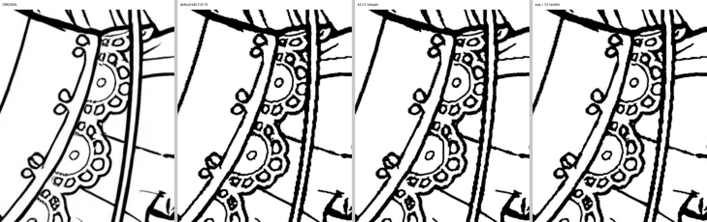
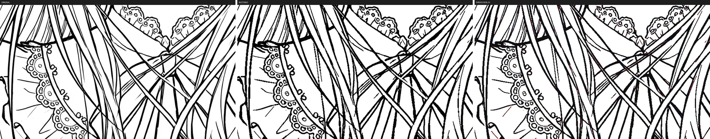
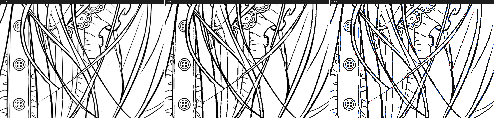
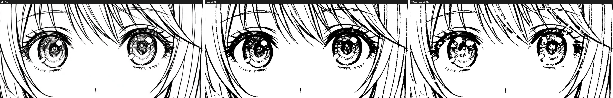
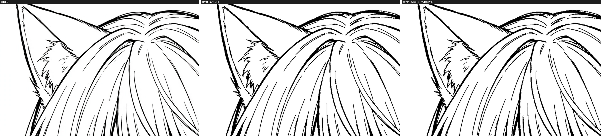
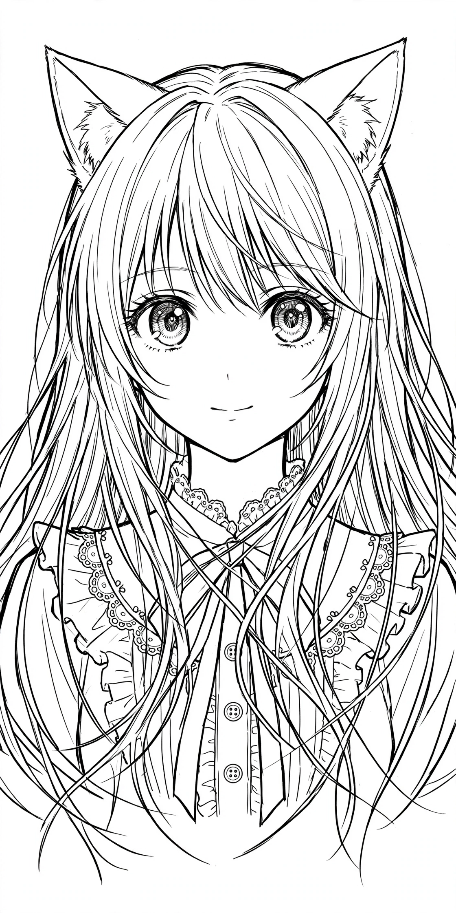

# line-trace-strokes

[](LICENSE)

ラスター線画を読み取り、**CLIP STUDIO PAINT のベクターレイヤー（.clip）**に
変換する一式。線は1本ずつ、線幅の変化（テーパー）つきでベクターになるので、
クリスタ上でそのまま編集できる。黒ベタは領域として検出して分離し、
輪郭を閉ストロークとして持ち、塗りはラスターレイヤーとして同梱する。

内部では線画を「可変半径ストローク」の JSON に変換し、交点で粉砕された
短いストロークを方向の連続性で繋ぎ直すチェイン化により、データを保ったまま
編集しやすい形にしている。.clip の読み書き自体は姉妹プロジェクト
[clipvec](https://github.com/nekomimianko/clipvec) が担う。


左が GUI ランチャー（Windows 用 exe）、右が変換結果の .clip を
CLIP STUDIO PAINT で開いたところ。ベクターレイヤー（line-trace）の
下に「ベタ塗り」ラスターレイヤーが入り、そのまま編集できる。

## インストール

### GUI（Windows）

**[LineToClip-v1.4.zip をダウンロード](https://github.com/nekomimianko/line-trace-strokes/releases/download/v1.4/LineToClip-v1.4.zip)**
解凍して `LineToClip\LineToClip.exe` を実行する（フォルダごと使うこと）。

- PyInstaller 製の実行ファイルです。
- Windows のセキュリティにブロックされることがあります。
- 初回起動は展開のため遅いです（ハングではありません）。2回目以降は速くなります。

### CLI

```bash
git clone --recursive https://github.com/nekomimianko/line-trace-strokes
cd line-trace-strokes
python -m venv .venv && .venv/bin/pip install numpy scipy scikit-image pillow shapely
.venv/bin/python line_to_clip.py input.png -o output.clip
```

## 使い方

GUI と CLI は同じ変換エンジンを使っており、パラメータは共通。
GUI は画像をドラッグ＆ドロップするとプレビューが出て、その場で
パラメータを調整して変換できる。CLI は `line_to_clip.py` に
画像を渡す。どちらも既定値のまま全工程（トレース → サブピクセル化 →
チェイン化 → ベタ検出 → 輪郭での切り取り → 間引き → .clip 化）が
走るので、パラメータをいじる必要は基本的にない。

### パラメータ（GUI / CLI 共通）

- **二値化しきい値**（CLI: `--threshold`、既定 180）：グレースケールで
  この値以下をインクとみなす。GUI のプレビューはこの2値化後の
  状態で表示される。
- **線のスムース化**（`--no-refine` で無効）：制御点を間引いて線を
  滑らかにする。
  - **線形状の許容誤差**（`--tol`、既定 0.3px）：中心線の形について
    許容するずれ。大きくすると線が滑らかになる（詳細は次の
    「間引きについて」）。
  - **半径（幅）の許容誤差**（`--eps-r`、既定 0.15px）：線幅について
    許容するずれ。大きくすると太さの出入りが均される。
- **ベタ判定**（`--no-beta` で無効）：黒ベタを領域として検出・分離する。
  GUI では検出結果がプレビューに赤で重なって表示される。
  - **深さ**（`--beta-depth`、既定 6px）：この深さより太い塊をベタと
    みなす。幅 12px までの線は線として残る。
  - **最小面積**（`--min-region-area`、既定 200px）：これ未満の領域は
    ベタにしない。
  - **輪郭形状の許容誤差**（`--contour-tol`、既定 0.75px）：ベタ輪郭の
    形について許容するずれ。
  - **輪郭の半径（幅）の許容誤差**（`--contour-eps-r`、既定 0.35px）：
    ベタ輪郭の線幅について許容するずれ。
  - **輪郭線の太さ**（`--contour-radius`、既定 1.0px）：ベタ輪郭
    ストロークの半径。
  - **ベタ塗りレイヤー**（`--no-fill-layer` で無効）：ベタ領域を黒で
    塗ったラスターレイヤーを .clip に同梱する。
- **チェイン**（`--no-chain` で無効）：交点で粉砕されたストロークを
  方向の連続性で繋ぎ直す。
- **曲線**（`--curve`、既定 spline）：.clip 内の制御点の補間方式
  （spline / straight）。

### 間引きについて

ベクター化したままのデータは、元の線をほぼそのまま再現できる。
一方で、制御点が標本点の数だけ（テスト画で 115,551 点）あって
そのままでは編集しづらく、元画像の線の汚さもそのまま出てしまう。

そこで、制御点を減らして線を滑らかにする「間引き」を標準で入れて
ある（`refine_strokes.py`）。既定値は元絵とほぼずれない控えめな値
（後述）にしてあるので、通常はそのままでよい。もっと滑らかに
したければ、形の平滑化は `--tol`、線幅の平滑化は `--eps-r` を
大きくする。いずれも単位は px で、**元の線からどれだけの距離
までのずれを許容するか**を表す（許容する距離が大きいほど結果は
滑らかになり、元の線からは離れる）。

出力の差はこの通り。左から元絵／既定（tol 0.3・eps_r 0.15）／
tol だけ 2.5 に上げたもの／eps_r だけ 1.0 に上げたもの。
tol を上げると線の通り道そのものが単純になる（瞳の放射線が整理され、
まつ毛の曲線が滑らかになる）。eps_r を上げると通り道はそのままで、
線の太さの出入りが均されていく。




- `--svg output.svg` を付けると、曲線フィッティング済みの輪郭 SVG も
  同時に出る（後述の `fit_curves.py`）。
- Blender グリースペンシルで使いたい場合は、できた .clip を clipvec の
  Blender アドオン（io_clip_vector）でインポートできる。
- clipvec の場所は `--clipvec PATH` / 環境変数 `CLIPVEC_PATH` でも指定できる。
  見つからない場合は取得方法が案内される。

## GUI について

`line_to_clip_gui.py` は上記の全工程をそのまま使う薄い GUI ラッパー。
画像をドラッグ＆ドロップするとプレビューが出て、主要パラメータ
だけを設定して変換できる。変換後は線＋ベタ塗りの合成プレビューが
表示される。プレビューは2値化後の状態で表示され、しきい値を変えると
その場で追従する。ベタ判定の深さ・最小面積もプレビューにライブ
反映され、検出されたベタ領域が赤で重なって表示される（表示だけ
1px 浸食してあるので、領域の縁の線も見える）。

配布用 exe は PyInstaller で作る（Python 環境ごと同梱される）：

```powershell
git clone --recursive https://github.com/nekomimianko/line-trace-strokes
cd line-trace-strokes
python -m venv .venv-build
.\.venv-build\Scripts\Activate.ps1
pip install -r requirements.txt pyinstaller
.\build_windows.ps1
# -> dist\LineToClip\LineToClip.exe（フォルダごと zip して配布）
```

動作確認はウィンドウなしでもできる：

```
LineToClip.exe --selftest input.png output.clip
```

## テスト結果（アニメ風線画 1120×2240）

左が元の線画、中央がストローク JSON **だけ** から復元した画像、右が誤差の重ね合わせ
（青＝欠損、赤＝過剰）。全体図では元と復元の見分けがつかない水準まで戻る。


拡大すると差が見えてくる。復元線の輪郭には、中心・半径が整数ピクセル標本であることに
由来する階段状の波打ちが残る（目の拡大、左＝元／中央＝従来復元／右＝誤差）。


レースと髪の交差部。交差・小円・ボタンなどのトポロジーは崩れていない。





入力そのものと復元単体は `examples/anime/anime_input.png` /
`examples/anime/medial_json_restored.png` / `examples/anime/medial_chained_restored.png` にある。

## パイプライン

```
ラスター線画 (PNG)
  │  line_trace.py      二値化 → 骨格化 → EDT で半径を付与
  ▼
variable-radius-strokes v1 JSON   （各点が x, y, r を持つストローク列）
  │  subpixel_refine.py 中心を EDT 重心でサブピクセル化（標準工程）
  │  chain_strokes.py   分岐点で端点を直進ペアリングして連結（任意）
  │  detect_beta.py     黒ベタ領域の検出と輪郭の抽出（標準工程）
  │  trim_strokes.py    ベタ輪郭でストロークを切り取る（標準工程）
  │  refine_strokes.py  階層細分による間引き（標準工程、控えめな既定値）
  │  prune_strokes.py   ごく短いストロークの除去（任意、チェインの後に）
  ▼
繋がったストローク JSON
  │  render_strokes.py  JSON だけから AA 付きで復元
  ▼
復元画像
```

- `line_trace.py` — グレースケール ≤180 で二値化し、`skeletonize` または
  `medial_axis` で中心線を取り、元の二値マスクの距離変換 (EDT) から各点の半径 `r` を拾う。
  骨格グラフを次数≠2 の点（端点・分岐点）で分割してストローク化する。
  medial_axis は `rng=0` 固定（未指定だと OS エントロピーで骨格が毎回わずかに揺れる）。
- `line_to_clip.py` — 代表スクリプト。画像を入れるだけで既定値の全工程を
  実行し、.clip を出す（冒頭の「使い方」参照）。
- `render_strokes.py` — JSON のみから、各点を 0.35px 間隔で補間しながら
  半径 `r − 0.5` の円をスタンプし、3倍解像度から縮小して AA を付ける。
  `--reference` を付けると元画像との IoU・欠損・過剰を測れる。
- `subpixel_refine.py` — 中心と半径のサブピクセル化（標準工程）。各内点で
  接線の法線方向に距離変換 (EDT) のプロファイルをサンプリングし、その重心へ
  中心を寄せ、半径はずらした中心で EDT を取り直す。整数ピクセル標本の
  量子化誤差を、ベクター側の平滑化（推測）ではなく入力側の情報から消す。
  IoU 93.43% → 97.40%（下記）。
- `chain_strokes.py` — 分岐点に集まった端点を「到着方向と出発方向が最も直進に
  近い相手」でペアリングし、ストロークを連結する。幾何には触らないので
  復元結果は変わらない（下記検証）。繋がらなかった短いストローク
  （棘・点・毛先の破片）は独立したまま残る。
- `detect_beta.py` — 黒ベタ領域（フィル領域）の検出と輪郭の抽出（標準工程）。
  距離変換で芯（既定は深さ 6px、絶対指定）を取り、各芯からマスク内だけを
  伝う測地膨張で領域を主張させる。ベタの輪郭は元のインク境界と一致し、
  付着した線は根元から深さぶんまでしか主張されない。輪郭は境界多角形を
  閉ストロークとして出し、`role: "fill_contour"` のマークを付ける。
- `trim_strokes.py` — ベタ領域の輪郭でストロークを切り取る（標準工程）。
  符号付き距離場で内外を判定し、輪郭との交点に新しい制御点（＝新しい
  端点）を挿入して、内側の点をすべて除去する。領域をまたぐ線は輪郭に
  きれいに着地し、ベタ内部の足場ストロークは消える。
- `prune_strokes.py` — 点数が閾値以下のストロークを除去する。
  チェイン化の後に使うこと（理由は下記の除去実験）。
- `refine_strokes.py` — 制御点の間引き（標準工程）。ストロークを
  始点・終点の直線から始め、元の線と合わない区間だけを2分割して
  制御点を増やしていく階層細分で、許容誤差内で点数を減らす。
  パラメータは中心線の形に対する `--tol` と線幅に対する `--eps-r`
  （いずれも px）。詳細と実測は後述の節を参照。
- `render_smooth.py` — 実験版の復元。Catmull-Rom 補間で中心線を滑らかにして
  なぞる。画素周期のジッター対策の検証用（本筋は上記3本）。

## 工程を分けて使う場合

```bash
# トレース (medial-axis 推奨)
.venv/bin/python line_trace.py input.png -o strokes.json --method medial-axis --preview-prefix medial

# 中心のサブピクセル化（標準工程）
.venv/bin/python subpixel_refine.py input.png strokes.json -o strokes_subpixel.json

# チェイン化
.venv/bin/python chain_strokes.py strokes.json -o strokes_chained.json

# ごく短いストロークの除去（任意。チェインの後に。≤5点は復元ほぼ無劣化、
# ≤10点まで削ると本数1,446・中央値34点と編集向けの粒度になる）
.venv/bin/python prune_strokes.py strokes_chained.json 5 strokes_pruned.json

# JSON だけから復元 + 元画像と比較
# （サブピクセル化したデータでは半径オフセット -0.35 が最適。未処理データは既定の -0.5）
.venv/bin/python render_strokes.py strokes_chained.json -o restored.png \
    --reference input.png --difference diff.png --overlay overlay.png --metrics metrics.json \
    --radius-offset -0.35

# 輪郭 SVG の曲線フィッティング（後処理、正式採用。長い線をベジェで滑らかにする）
.venv/bin/python fit_curves.py strokes_chained.json -o curved.svg
```

## 実測結果（アニメ風線画 1120×2240、`examples/anime/`）

入力は猫耳・レース・髪の交差を多く含む生成線画。インク画素 417,773（閾値180）。

| 方式 | ストローク数 | 点数 | IoU | 欠損 | 過剰 |
|---|---:|---:|---:|---:|---:|
| skeletonize | 9,027 | 119,312 | 89.07% | 42,742 | 3,294 |
| medial-axis | 10,434 | 122,086 | 93.43% | 23,549 | 4,169 |
| medial-axis + チェイン化 | **3,890** | 115,542 | **93.43%** | 23,550 | 4,168 |
| medial-axis + サブピクセル化（中心＋半径再計算） | 10,434 | 122,086 | **97.40%** | 5,008 | 5,994 |
| 〃 + チェイン化 | 3,909 | 115,561 | **97.40%** | 5,008 | 5,994 |

チェイン化の内訳: 分岐点 6,315 箇所で 6,545 組を連結。平均長 11.7点 → 29.7点、
最長 454 → 781点、5点以下の断片 6,751本 → 1,952本。
20点以上のストロークが全点の86%をカバーする（チェイン前は65%）。

### チェイン化で復元が劣化しないことの検証

太い線や交点にある細かいストロークも復元に寄与しているはずであり、
チェイン化でそれらを失えば復元は劣化する。実際に失われていないことの確認:

- 点数の減少 6,544点 = 連結箇所で二重になっていた分岐点の重複そのもの。
  短いストロークは捨てられていない。
- 復元画像同士の直接比較: 二値で食い違うのは **全2,508,800画素中 2画素** のみ
  （分岐点で端点スタンプが重なっていた箇所が1pxずつ変わる）。
  グレースケール差も50画素のみ。`examples/anime/comparison_chained_diff_zoom.png` 参照。

### 短いストロークの除去実験

点数が閾値以下のストロークを捨ててから復元するとどうなるか（`prune_strokes.py`）。
数値はサブピクセル化（中心＋半径再計算）後のデータで測定したもの
（復元オフセット −0.35、除去しない場合の IoU は 97.40%）。
それ以前の測定は git 履歴参照。
結論の向きは変わらず、全条件で IoU が底上げされた。
なおサブピクセル化後のチェイン化は 3,909本になる（方向ベクトルが微妙に
変わり、連結が19本分減る）。

| 除去する短さ | 未チェインから除去 | チェイン済みから除去 |
|---|---:|---:|
| ≤2点 | 97.31%（2,945本除去） | — |
| ≤3点 | 96.91%（4,498本） | 97.39%（1,114本） |
| ≤5点 | 94.45%（6,751本） | **97.39%（1,971本）** |
| ≤10点 | 87.49%（8,254本） | 96.71%（2,463本） |

- 未チェインで ≤5点まで捨てると IoU は −2.95pt に留まるが、**視覚的には目が壊れる**。
  瞳の放射状の刻み・下まつ毛・細い髪の流れが点線化して消える。短いストロークの
  固有寄与は面積ではなく細部の密度に詰まっている
  （≤5点除去でだけ失われるインク 17,541px が目・耳の毛・髪の際に集中する）。




- 一方、**チェイン化の後なら ≤5点まで除去しても IoU はほぼ不変で、目も残る**。
  ≤10点まで広げても −0.69pt に留まる。チェイン化が「長い線の一部だった
  断片」を先に回収するため、残る短いストロークは太いインク内部の冗長な棘が
  中心になる。捨てるならチェインの後に。


### 除去後のストローク構成（編集可能性）

チェイン済みから除去したとき、残りはどのくらいの長さにまとまるか。

| 条件 | 本数 | 中央値 | 平均 | 最長 | IoU |
|---|---:|---:|---:|---:|---:|
| チェインのみ | 3,909 | 5点 | 29.6点 | 781点 | 97.40% |
| ≤5点除去 | 1,938 | 22点 | 56.3点 | 781点 | 97.39% |
| ≤7点除去 | 1,666 | 28点 | 64.4点 | 781点 | 97.18% |
| ≤10点除去 | 1,446 | 34点 | 72.9点 | 781点 | 96.71% |

- ≤10点除去では21点以上が1,017本（全体の70%）を占め、インクの95%を
  20点以上のストロークが担う。100点以上のストロークでインクの64%をカバーし、
  髪の流れや輪郭などの骨格はこの層にある。バストアップ1枚で約1,400本・
  中央値34点は、ベクター編集で1本ずつ扱う粒度として現実的
  （1本＝髪1筋、輪郭1区間程度の意味のある単位になる）。
- 残る11〜20点の429本はノイズではなく、レースの小円・まつ毛・ボタンの縁など
  実在の小パーツである。除去は≤10点あたりが打ち止めで、それ以上は
  パーツ自体が消え始める。
- 注意: ストロークの切れ目は交点の位置にあるため、見た目に1本の線でも
  交点を跨ぐと2〜3本に分かれている。編集で動かす際は交点付近の追随が課題。
- 未チェインからの除去では本数は減っても骨格が弱いままである
  （≤10点除去で2,180本・中央値25点、≥50点のカバー率は57.9%止まり、
  IoU も87.49%まで落ちる）。編集の土台にするならチェイン経由が前提。

### 復元誤差の性質（medial-axis、未チェイン）

- 欠損の99%は元のインクの境界画素で、復元までの距離の中央値は1px。
  線が消えるのではなく、`r − 0.5` の一律引き算と整数ピクセル中心の離散化で
  全体が均一に少し細くなる。内側の欠損率は0.16%。
- 半径オフセットは −0.5 がほぼ最適（0 で過剰が爆増し IoU 77.4%、−0.25 で 92.7%）。
- 拡大すると中心と半径の画素周期ジッターで輪郭が階段状に波打つ。これが残る課題で、
  対策はトレース側のサブピクセル中心化にある（次節）。復元側の平滑化は
  推測になる分だけ不利で、実測でも IoU が下がった（Catmull-Rom 93.01%）。

### サブピクセル中心化（標準工程として採用）

中心と半径は整数ピクセル標本であり、その ±0.5px の量子化誤差が輪郭の
階段状ジッターになる。この誤差はベクター内平滑化（推測）ではなく、
トレース時に前段で消すのが正しい — という方針で検証し、標準工程に採用した
（`subpixel_refine.py`）。各内点で接線の法線方向に重みプロファイルを
サンプリングし、その重心へ中心を寄せる（±0.6px クランプ、端点は交点維持
のため固定、平均移動量 0.26px）。

| 重み | IoU | 欠損 | 過剰 | 中心線の凹凸（2階差分平均） |
|---|---:|---:|---:|---:|
| なし（整数中心） | 93.43% | 23,549 | 4,169 | 0.331px |
| **EDT（距離場）** | **95.90%** | **12,632** | 4,695 | 0.240px（−28%） |
| グレー濃度 | 93.46% | 22,144 | 5,525 | 0.204px（−39%） |

- EDT 重心が本命。欠損がほぼ半減する。EDT プロファイルは線の塊の中での
  中心を素直に表すため、量子化誤差だけを拾って直せる。
- グレー濃度重心は中心線自体は最も滑らかになるが IoU は動かない。
  隣接線や AA の濃淡に引っ張られ、塊の中心からずれるため。
  「滑らかさ」と「正確さ」は別物である。
- 半径は、ずらした中心で EDT を双線形サンプリングして取り直す。
  中心だけ直して半径が旧中心の値のままでは実測点がずれるためで、
  これにより **IoU 97.40%**（復元オフセット −0.35、欠損 5,008／過剰 5,994）
  まで伸びる。半径の平滑化（移動平均）は逆効果だった
  （±1点で 96.29%、±2点で 95.36%）：半径の段差はノイズではなく
  本当の幅変化を担っている。
- 濃度プロファイルの FWHM からの半径推定はベタ部の plateau で壊れた
  （IoU 75.95%）ため不採用。
- オフセットの最適は工程ごとに移る：整数中心 −0.5 → 中心のみ −0.4 →
  中心＋半径再計算 −0.35。従来の −0.5 最適は中心誤差の裏返しだった。




### 合成図形テストとの差

螺旋・交差・楕円などの合成図形 (1536×1024) では medial-axis で IoU 99.34% /
295ストロークだった。実線画で落ちる主因は精度よりもストロークの粉砕
（分岐点 210 → 7,914) であり、チェイン化はそこへの対処。

## 黒ベタ領域の分離（`detect_beta.py` + `trim_strokes.py`、標準工程）

黒ベタは丸ブラシのストロークでは戻せない（ベタ内部の骨格は足場にすぎない）ため、
ベタ領域を先に検出して分離し、別処理に回す。線はベタ輪郭で切り取り
（`trim_strokes.py`）、輪郭そのものは閉ストロークとして持つ。

- 検出：距離変換で芯（既定は深さ 6px の絶対指定。線をかなり太めに想定し、
  幅 12px までの線は線として残す）を取り、各芯から元マスク内だけを伝う
  測地膨張を深さの回数まで行って領域を主張させる。ベタの縁は芯から
  深さ以内にあるので塊は丸ごと復元され（輪郭は元のインク境界と一致）、
  付着した線は根元から深さぶんまでしか主張されない。主張がぶつかる
  くびれが領域の割れ目になる。領域マスクがインクの外に出ることはない。
- 輪郭：領域ごとにマーチングスクエアで境界多角形を取り、閉ストローク
  として出す（`role: "fill_contour"`、領域 id 付き）。間引きは
  `refine_strokes.py` の閉曲線細分が担う（既定 tol 0.75px）。
- .clip への適用（正式採用）：ベクターデータは全て線のまま（ベタは輪郭の
  閉ストローク）。それとは別に、領域を黒でフィルした画像をラスター
  レイヤー「ベタ塗り」としてベクターレイヤーの下に同梱する。クリスタ
  上では完成画として見え、ベクター側はそのまま編集できる
  （`--no-fill-layer` で同梱を切れる）。フィル領域としてのマークは
  中間 JSON にも残る。


生成画の .clip を CLIP STUDIO PAINT で開いたところ。下の「ベタ塗り」
ラスターレイヤーがベタを表示し、上のベクターレイヤーでは輪郭と線が
制御点つきで編集できる。

実測（生成モノクロ画 1024×1280、IoU は間引き済み線＋領域 vs 原インク、
`render_strokes.py` で測定）：

- 髪ベタ＋黒服＋瞳の画：21 領域（インクの 89.1%）、最終 3,109 本／33,906 点、IoU 98.66%
- ベタ過多の画：5 領域（96.6%）、912 本／11,280 点、IoU 99.55%
- 別 seed の画：18 領域（91.9%）、1,814 本／22,192 点、IoU 99.20%
- 線画テスト画（負の対照）：12 領域（インクの 1.4%、瞳・まつ毛の太い部分のみ）、
  最終 3,903 本／94,963 点で、ベタ処理なしの従来工程（95,412 点）と同等

## 既知の限界

- IoU は二値化した線との重なりであり、グレーの AA や元の筆順の復元は意味しない。
- 8近傍グラフの分岐処理はヒューリスティクス。太い塊の内部では骨格が余分に枝分かれする
  （検出されたベタ領域の内部については、上記の分離＋切り取りで除去される）。
- 中心と半径は `subpixel_refine.py` でサブピクセル化される。残る誤差は
  ポリライン近似（約1px間隔の標本を直線で繋ぐ）と残留中心ノイズが主で、
  これはベクター側の間引き（次節 `refine_strokes.py` の線分分割）の領域である。

## 後処理：ε制約つき平滑化（`smooth_strokes.py`、実験的）

平滑化の標準は後述 `refine_strokes.py` の線分分割による間引きであり、
こちらはそれ以前に検証した実験的な後処理として残してある。
平滑化は測定ではなく編集（後処理）である。無制約の平滑化は忠実度を落とす
ことが実証済みのため、中心は実測位置から ε px、半径は実測値から ε_r px
以上は離れない制約のもとでラプラシアン緩和をかける。端点は固定され、
チェインの接続は保たれる。実測（基準：中心ジッター 0.249px／半径ジッター
0.159px／IoU 97.40%）：

| ε / ε_r / 反復 | 中心ジッター | 半径ジッター | IoU |
|---|---:|---:|---:|
| 0.15 / 0.08 / 15（既定） | 0.093 | 0.097 | 96.19% |
| 0.20 / 0.10 / 20 | 0.064 | 0.085 | 95.61% |
| 0.30 / 0.15 / 40 | 0.037 | 0.060 | 94.30% |

コストは構造的で、緩和が曲率を内側に切る方向へ制約予算を使うため、
滑らかさと忠実度は直接トレードオフになる。編集先で滑らかさが要る場合に
だけ使う。

## 後処理：階層細分による間引き（`refine_strokes.py`、標準工程）

トレースした標本点がそのまま制御点になると、テスト画で 115,551 点と
なりクリスタ上での手編集には密すぎる。`refine_strokes.py` は
ストローク（鋭角で分割済み）を始点・終点の2点直線から始め、各区間と
元の線の最大ずれを測り、許容を超えた区間だけを中点の標本で2分割する
ことを、全部の区間が許容内に収まるまで繰り返す。曲率を隣接標本の
差分で測らないので、緩い部分は粗いまま、きつい部分だけ細かくなる
（細分の深さが多重スケールの曲率指標になる）。制御点は常に元の線の
上にあり、半径は元の値そのままである。閉ストロークは円周上の4点
から循環細分する。

パラメータは2つ。いずれも単位は px で、**元の線からどれだけの距離
までのずれを許容するか**を表す（許容する距離が大きいほど、元の線に
合わせるための分割が少なくなり、結果は滑らかになる代わりに元の線
からは離れる）:

- `--tol` — 中心線の**形**について許容する距離。結果の中心線が元の
  中心線からこの距離以内に収まるよう分割する。大きくすると
  ストロークの形が平滑になる。
- `--eps-r` — **線幅**（ブラシサイズの変化）について許容する距離。
  制御点間で直線補間した半径が、元の半径からこの距離以内に収まる
  よう分割する。大きくすると太さの出入りが平滑になる。

既定値は **tol 0.3 / eps_r 0.15** と、元絵とほぼずれない控えめな値に
してある。形を平滑にしたければ tol を、線幅を平滑にしたければ
eps_r をパラメータで増やす。

テスト画（下記、`examples/anime/anime_input.png`、1120×2240）での
実測範囲はこの通り（点数はチェイン済み 115,551 点に対する値、
IoU はスプライン描画での復元値。密トレース自体の上限は 97.40%）:



| tol | eps_r | 点数 | IoU |
|---:|---:|---:|---:|
| 0.1 | 0.05 | 113,455 | 97.27% |
| 0.25 | 0.10 | 104,533 | 97.16% |
| **0.3（既定）** | **0.15** | **95,412** | **96.78%** |
| 0.75 | 0.35 | 48,835 | 92.95% |
| 1.5 | 0（中心のみ） | 25,085 | 84.21% |

- ε を 0 に近づけると密トレースそのものに収束する（tol 0.1 で
  98.2% の点が残る）。ただし近づく先はトレース済みの中心線であり、
  二値化段階の喪失はここでは取り返せない。また 0.25px 以下では
  トレース自体の測定ノイズ（中心ジッター約 0.24px）を拾いに行く。
- この絵では点数の大半を eps_r 側の分割が食う。中心線の一致は
  安く（tol 1.5・中心のみで 25,085 点）、太さの変化は至る所にある
  ためである。tol だけ緩めても点数が減らない場合は eps_r を見る。
- 目視では、ボタンやレースの小さい円は tol 1.5 でも丸さを保ち、
  長い線は強めるほど綺麗になる。

## フォーマット変換：SVG（`svg_export.py`）

編集は他ソフトに任せる前提の汎用書き出し。

- **outline モード（既定）**：円盤掃引の和集合で作った塗りシルエット。
  テーパーを保持する。実測 IoU **96.09%**（simplify 0.1、2.2MB）／
  simplify 0 では 96.40%（8.3MB）。法線オフセットのリボン方式は急カーブで
  潰れるため不採用（90.17%）。輪郭抽出（マーチングスクエア）は AA の
  薄い橋で全体が1ループ化し不採用。
- **centerline モード**：1ストローク1パスの線。SVG の線幅は1パスに
  1値しか持てないため、線幅の変化（テーパー）はこの形式では表現できず
  失われる。
- 座標系の注意：JSON はピクセル中心座標、SVG は隅原点のため全体を
  (0.5, 0.5) 平行移動して出す。これを省くと IoU は ~79% まで落ちる。
- 輪郭の最適オフセットは −0.2。スタンプ復元の −0.35 との差は
  ラスタライザ側の太り（PIL の円描画）によるもので、データの差ではない。

## 後処理：曲線フィッティング（`fit_curves.py`、正式採用）

ポリライン輪郭をベジェ曲線に置き換える後処理として正式採用した
（2026-11-25）。価値は「長い線がシンプルかつ滑らかになる」ことで、
全ストロークに効くわけではない。`svg_export.py` の outline が前提。

当てはめ誤差は、幾何の変化が一番速い場所 — 線端と短いストローク —
に集中する。全面を一様に当てはめると（ε=0.5）IoU は **91.00%** まで
落ち、その喪失の大半が端と短いストロークの分だった。そこで端は
別処理にする：

- シルエットはストロークごとに作る（端の定義がストロークの弧長に
  依存するため）。両端から弧長 **10px** 以内の輪郭点はアンカーとして
  ε=0.1 で密に当てはめ、ベジェのハンドルも畳んで実測幾何に張り付ける。
  急な角（方向変化 >65°）も同様に角として保持する。
- 長いストロークの中間だけを ε=0.3 でベジェ化する
  （Douglas-Peucker で制御点を選び、周期 Catmull-Rom → 3次ベジェ）。
- 全長 20px 以下のストロークは全体が端ゾーンなので、ε=0.1 の密な
  当てはめ（短いセグメント列）にする。テスト画では 3,909 本中
  2,769 本（71%）がこれに当たる。表現は全面ベジェで統一され、
  変わるのはセグメントの密度だけである。

実測（既定値、チェイン済みサブピクセルデータ）：

| 方式 | IoU | 制御点 | サイズ |
|---|---:|---:|---:|
| ポリライン輪郭（simplify 0.1） | 96.09% | — | 2.2MB |
| 曲線化・全面一様（ε=0.5） | 91.00% | 33,467 | 1.5MB |
| **曲線化・端別処理（本方式）** | **96.01%** | 290,213 | 13.3MB |

- 忠実度はポリラインと実質同点まで戻る。ただし圧縮の旨みは薄い：
  忠実さが要るゾーンはどう書いても点が要り、ベジェは1セグメントの
  記述が重い。得られるのはファイルサイズではなく、長い線の
  滑らかさと編集しやすさである。
- 位置づけの注意：本方式は SVG 輪郭専用の後処理である。.clip 化の
  間引き・平滑化は `refine_strokes.py` の線分分割（階層細分）が担って
  おり、fit_curves は経由しない。端を別処理にする考え方自体は、
  refine 側でも鋭角の保持として生きている。

## 今後の候補

- 中心線の間引きは `refine_strokes.py`（階層細分）として実装し、
  控えめな既定値で標準工程に入れた（上記）。
- 最小二乗ベジェ当てはめ（Schneider 法）：同じ ε をより少ない
  セグメントで達成し、曲線化の圧縮率を上げる。

## ファイル

- `line_to_clip.py` / `line_trace.py` / `render_strokes.py` / `subpixel_refine.py` /
  `chain_strokes.py` / `detect_beta.py` / `trim_strokes.py` / `prune_strokes.py` / `refine_strokes.py` / `thin_strokes.py` /
  `stabilize_strokes.py` / `smooth_strokes.py` / `svg_export.py` /
  `fit_curves.py` / `render_smooth.py` — 本体
- `examples/anime/` — テスト入力・トレース結果 JSON（未チェイン／チェイン済み）・
  復元・比較画像

## ライセンス

MIT License（`LICENSE` 参照）。
